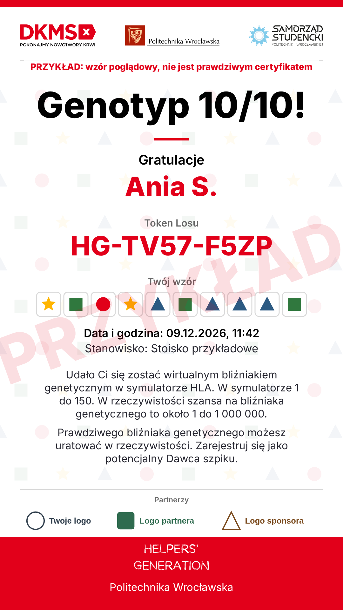
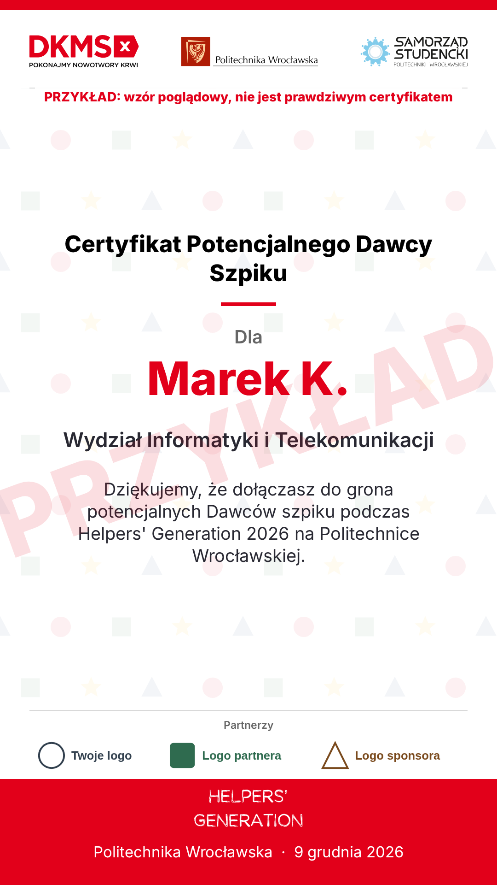
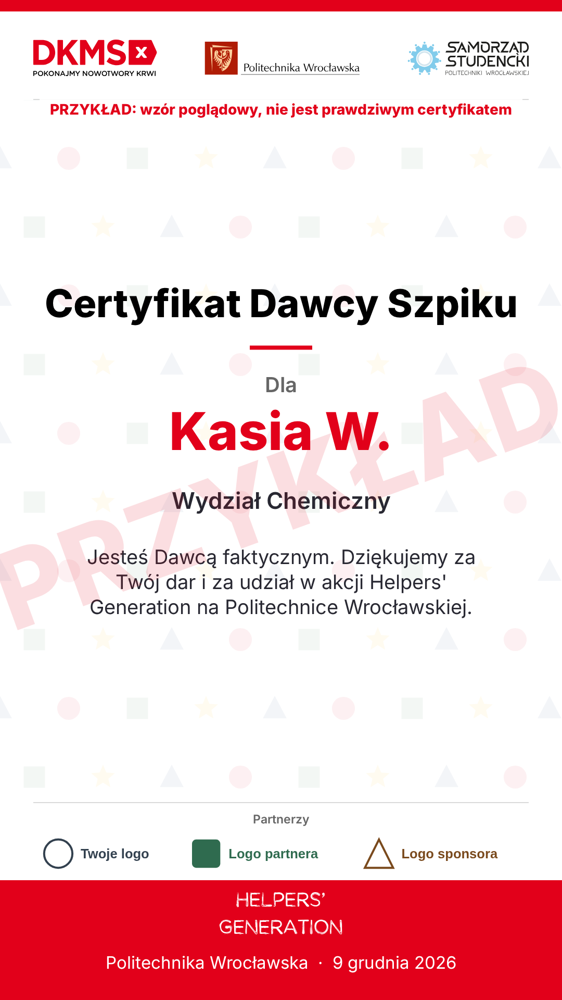
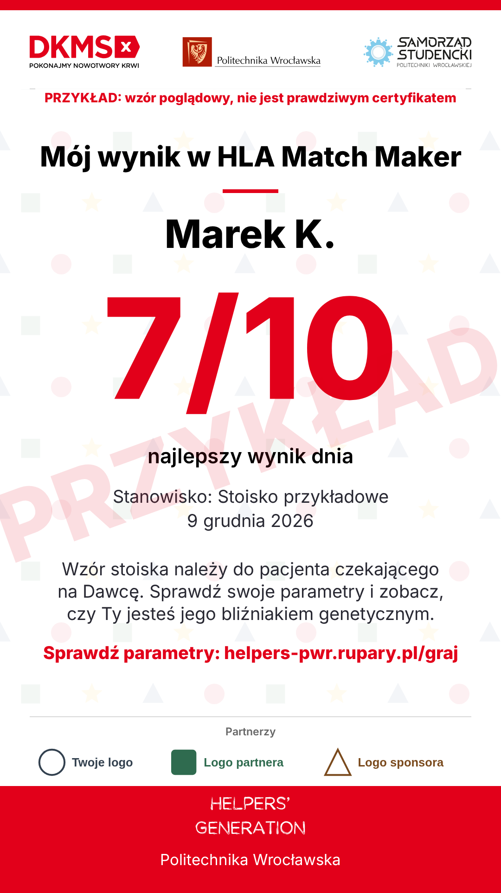
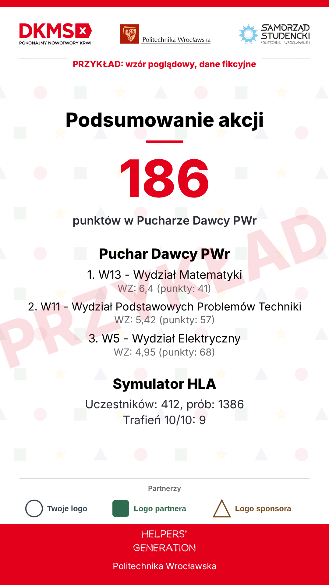
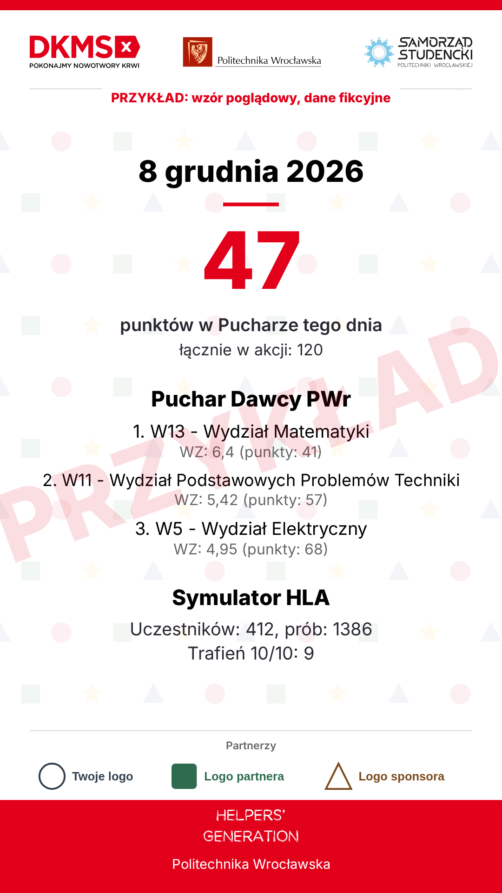
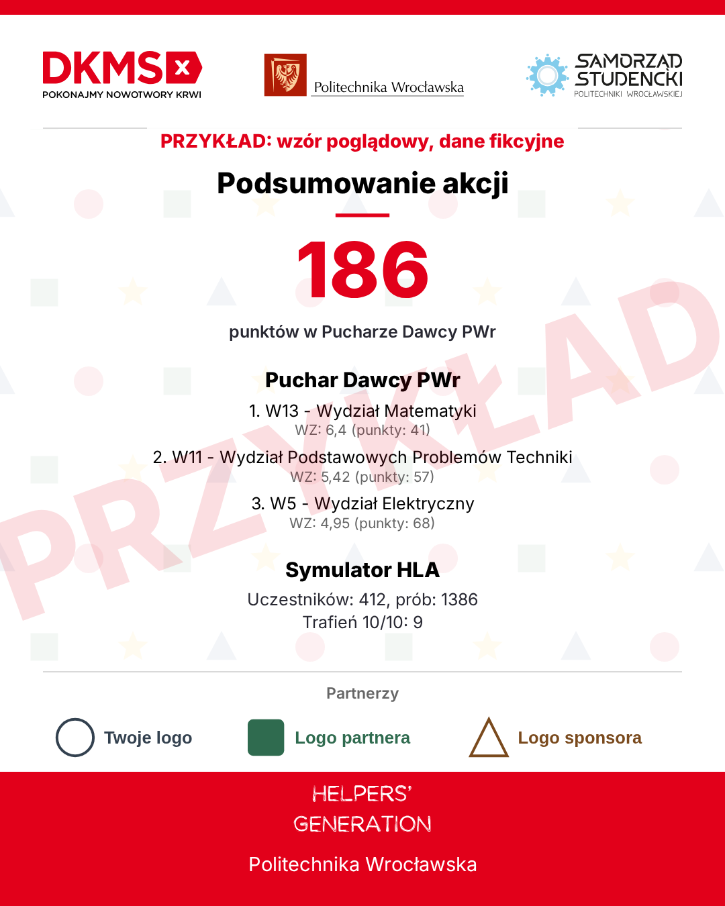
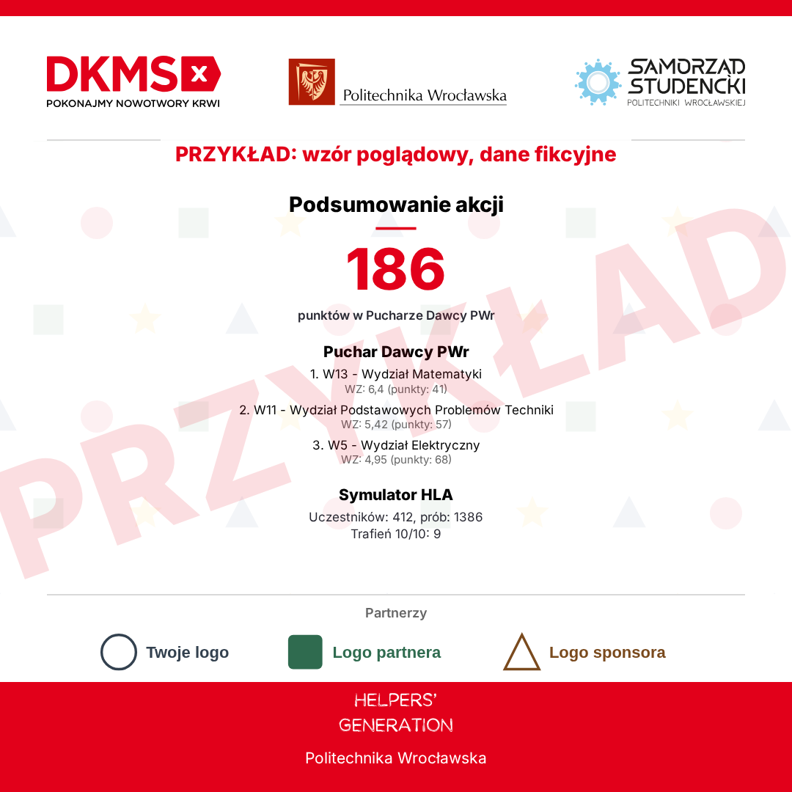
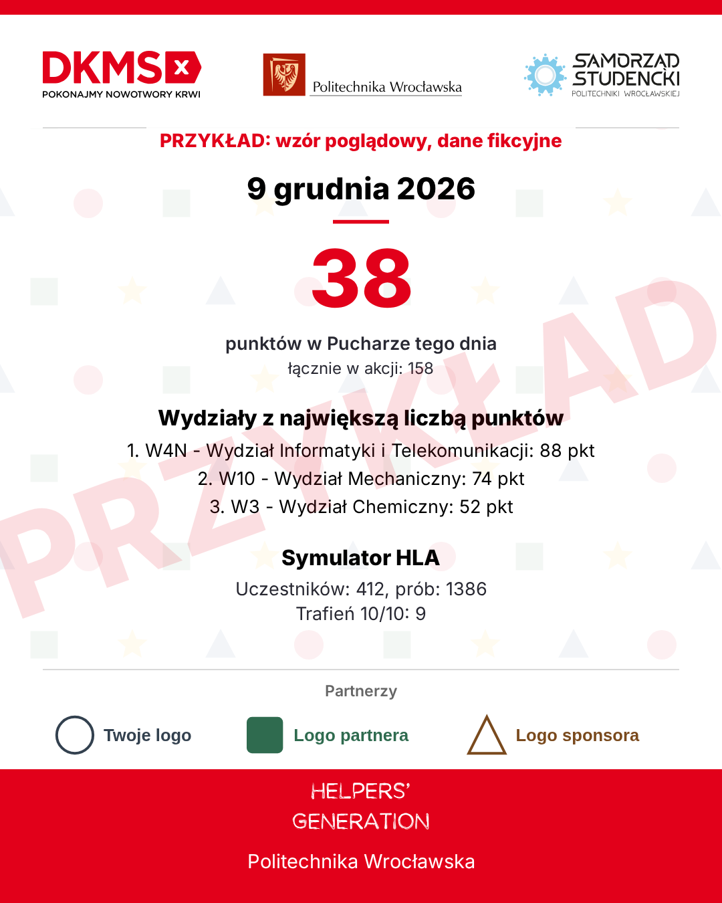

# Oferta współpracy dla partnerów: studencka akcja rejestracji dawców szpiku na Politechnice Wrocławskiej

**Prosimy o wsparcie studenckiej akcji (upominki, nagrody lub środki na jej organizację), a w zamian pokażemy logo Państwa firmy na grafikach akcji i publicznie wymienimy fundatora nagrody.**

Organizator: Samorząd Studencki Politechniki Wrocławskiej, we współpracy z zespołem akcji Helpers' Generation.

## Czym jest akcja

Od 7 do 11 grudnia 2026 r. na kampusie Politechniki Wrocławskiej społeczność akademicka może zarejestrować się jako potencjalni dawcy szpiku kostnego i komórek macierzystych. To akcja studencka, prowadzona w ramach inicjatywy Helpers' Generation. Niniejsza oferta pochodzi od organizatorów studenckich, a nie od Fundacji DKMS.

Wokół rejestracji działają dwie inicjatywy, które potrzebują nagród:

- **HLA Match Maker**: internetowy symulator doboru dawcy i pacjenta, połączony z konkursem. Uczestnicy, którzy uzyskają w symulatorze wynik 10/10 i pobiorą certyfikat z Tokenem Losu, układają hasła edukacyjne obalające mity o dawstwie szpiku (np. o bólu czy wkłuciu w kręgosłup). Komisja konkursowa ocenia merytorykę, kreatywność i siłę przekazu. Konkurs nagradza hasła i nie jest grą losową.
- **Puchar Dawcy PWr**: turniej wydziałów. Wygrywa wydział z najwyższym wskaźnikiem zaangażowania, czyli liczbą punktów w stosunku do liczby studentów wydziału. Zwycięska społeczność dostaje tytuł, puchar i grant uczelniany.

Wyniki konkursu i turnieju ogłaszamy 13 grudnia 2026 r. na oficjalnych kanałach Samorządu Studenckiego PWr. Szansa na znalezienie „bliźniaka genetycznego" wśród niespokrewnionych osób wynosi około 1 do 1 000 000, i właśnie o to, żeby baza dawców była większa, chodzi w całej akcji.

## Czego oczekujemy

Forma jest dowolna, wsparcia można łączyć:

1. **Drobne gadżety i upominki** (np. materiały firmowe, kubki, notesy), które trafią do laureatów konkursu albo będą rozdawane na stoiskach niezależnie od rejestracji.
2. **Większy gadżet lub nagroda** na nagrodę główną w konkursie HLA Match Maker.
3. **Nagrody do Pucharu Dawcy PWr**: wsparcie rzeczowe dla społeczności zwycięskiego wydziału, najlepiej wyposażenie strefy studenta (np. pufy, meble relaksacyjne, sprzęt AGD lub multimedialny). To nagrody dla wspólnoty wydziału, a nie dla pojedynczych osób.
4. **Wsparcie finansowe akcji**: pokrycie kosztów jej organizacji, ustalone z Organizatorem. Wsparcie to nie zwiększa grantu Pucharu.

## Co otrzymuje partner

- **Logo na pasku „Partnerzy"** na wszystkich grafikach generowanych przez serwis akcji: na certyfikacie 10/10 z Tokenem Losu, certyfikatach potencjalnego i faktycznego dawcy, grafice z wynikiem symulatora oraz na grafikach podsumowujących akcję i poszczególne dni (formaty 9:16, 4:5 i 1:1). Pasek znajduje się nad czerwonym pasem Helpers' Generation. Certyfikaty i wynik z symulatora uczestnicy pobierają na własne urządzenia, a grafiki podsumowujące przygotowuje Organizator.
- **Wymienienie nagrody i fundatora** przy ogłoszeniu listy nagród na profilu Organizatora oraz na stoiskach akcji, najpóźniej 7 grudnia 2026 r. (§7.2 regulaminu konkursu).

Jesteśmy akcją studencką, dlatego nie gwarantujemy konkretnych zasięgów ani liczby uczestników, a oferta nie obejmuje własnych stoisk partnera ani prelekcji. Partner wspiera akcję studencką; nie zostaje partnerem Fundacji DKMS i nie otrzymuje prawa do używania logo DKMS, Politechniki Wrocławskiej ani Samorządu Studenckiego (te logotypy występują na grafikach jako część akcji).

### Przykładowe grafiki (dane i logotypy fikcyjne)

Poniższe grafiki wygenerowano kodem serwisu akcji. Imiona, tokeny i liczby są wymyślone, a na każdej widnieje znak „PRZYKŁAD".

| | | |
|---|---|---|
|  |  |  |
| Certyfikat 10/10 z Tokenem Losu | Certyfikat potencjalnego dawcy | Certyfikat dawcy faktycznego |

| | | |
|---|---|---|
|  |  |  |
| Wynik w symulatorze | Podsumowanie akcji i ranking Pucharu (9:16) | Podsumowanie dnia (9:16) |

| | | |
|---|---|---|
|  |  |  |
| Podsumowanie akcji (4:5) | Podsumowanie akcji (1:1) | Podium wydziałów (4:5) |

## Ważne zasady

- **Rejestracja jest świadoma, bezpłatna i bezinteresowna.** Upominki i nagrody nigdy nie są zapłatą za rejestrację w bazie dawców (§1.6 regulaminu konkursu, §1.4 regulaminu Pucharu). Drobne upominki trafiają do laureatów konkursu albo są rozdawane niezależnie od rejestracji.
- **Partner nie otrzymuje żadnych danych uczestników**, a akcja nie zbiera ich w celach marketingowych.
- **Grant Pucharu (3 000 zł) pochodzi ze środków uczelnianych** i może być wydany wyłącznie na infrastrukturę studencką wydziału (§5 regulaminu Pucharu). Wsparcie finansowe partnera nie zasila grantu, a nagrody do Pucharu nie mogą być nagrodami indywidualnymi.
- **Konkurs nagradza hasła, nie jest losowaniem** (§1.7). Laureaci nie mogą żądać zamiany nagrody na ekwiwalent pieniężny (§7.3).
- Organizator może odmówić współpracy, jeśli partner nie pasuje do charakteru akcji.

## Logo: wymagania techniczne

Pliki PNG, JPG, WebP lub SVG, do 1,5 MB. SVG musi mieć określone atrybuty `width` i `height` oraz nie może zawierać skryptów ani odwołań zewnętrznych. Najlepiej przesłać logo na przezroczystym lub białym tle (pasek partnerów jest biały), w poziomym układzie.

## Kroki i terminy

1. Zgłoszenie chęci współpracy i wstępna deklaracja formy wsparcia.
2. **Do 30 listopada 2026 r.**: potwierdzona deklaracja (rodzaj i wartość wsparcia) oraz plik z logo.
3. **Przed 7 grudnia 2026 r.**: nagrody muszą być znane Organizatorowi, aby można je było ogłosić (§7.2 regulaminu konkursu).
4. 7 do 11 grudnia 2026 r.: akcja. 13 grudnia 2026 r.: ogłoszenie wyników.
5. Przekazanie nagród laureatom zgodnie z ustaleniami z Organizatorem.

Dane do wpłat i forma rozliczenia: **[do uzupełnienia]**

## Kontakt

[imię i nazwisko], [telefon], [e-mail]

Samorząd Studencki Politechniki Wrocławskiej, Wybrzeże Wyspiańskiego 27, 50-370 Wrocław, we współpracy z zespołem akcji Helpers' Generation.
